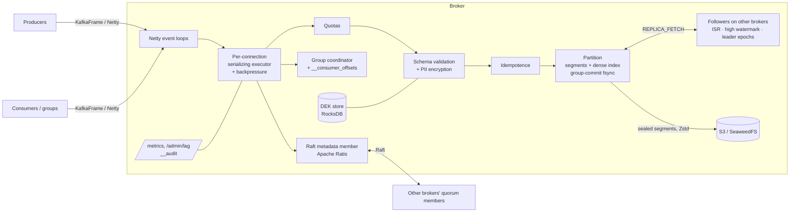
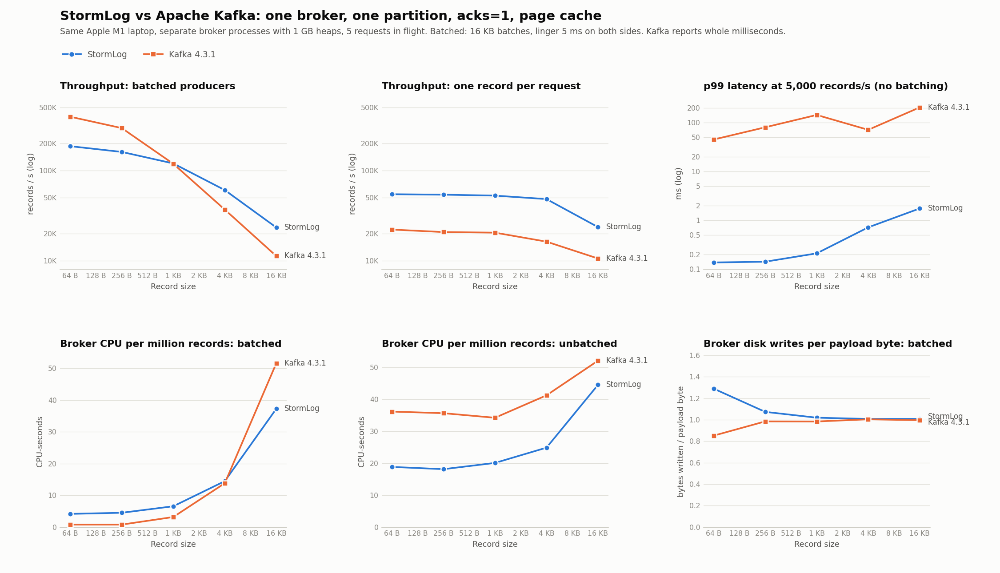

# StormLog: a Kafka-style log broker, built from scratch in Java

StormLog is a replicated, partitioned, append-only log broker in Java 25: segmented storage with
group commit and crash recovery, leader–follower replication with an ISR, high watermark and
leader-epoch truncation, a pipelined binary protocol on Netty, idempotent producers, consumer
groups with cooperative rebalancing, tiered storage to S3, and an embedded Raft metadata quorum
(Apache Ratis) instead of ZooKeeper. It also has two things Kafka doesn't ship: broker-side
Avro schema enforcement and GDPR crypto-shredding of tagged fields. Every performance number
below is measured through the broker's real request path and states its durability mode, and
each design decision and failure mode is written down in [`docs/`](docs).

## Architecture



Each broker embeds a member of the metadata quorum, and the Raft leader acts as the controller.
Metadata (brokers, topics, partition leadership and ISR, schemas, wrapped data keys, erasures) is
a replicated state machine. Partition data replicates separately, Kafka-style: followers pull
from the leader, and the data path never touches consensus. See
[`docs/replication.md`](docs/replication.md).

## Quick start

Requires JDK 25. Maven comes with the wrapper.

```bash
# Build and run the tests (119). -Dbuild.dir keeps CLI builds apart from an IDE compiling into target/
./mvnw test -Dbuild.dir=target-cli

# A real 3-broker cluster on one machine: produce, consume, a poison pill to the DLQ,
# kill -9 the controller, failover, restart, metrics. No Docker needed.
./mvnw package -Dbuild.dir=target-cli -DskipTests
./scripts/demo-cluster.sh
```

A recorded run of the demo is in [`docs/demo-transcript.md`](docs/demo-transcript.md).

S3 tiering is tested against [SeaweedFS](https://github.com/seaweedfs/seaweedfs)'s S3 API
(MinIO's community binaries are no longer distributed); any S3-compatible endpoint works.

Clients: `SimpleKafkaClient` (one record per request), `BatchingProducer` (Kafka-style batching,
optionally idempotent), `GroupConsumer` (consumer groups).

CLI: `java -cp target-cli/simple-kafka-1.0-SNAPSHOT.jar com.simplekafka.cli.StormLogCli --bootstrap HOST:PORT <command>`
with `describe`, `create-topic`, `produce`, `produce-batch`, `consume`, `consume-group`,
`consume-with-dlq`, `commit`, `forget-entity`.

## Benchmarks

### Through the broker (in-process clients, 1 KB records, one partition)

From [`BrokerBenchmark`](src/test/java/com/simplekafka/storage/BrokerBenchmark.java): real Netty
connections into the broker's full produce path. Full matrix and caveats are in
[`docs/durability.md`](docs/durability.md).

| Durability | Connections × in flight | Throughput | p99 |
|---|---|---|---|
| Page cache (default) | 1 × 16 | ~78K–121K op/s | < 1 ms |
| Page cache, idempotent | 16 × 16 | ~57K–70K op/s | ~10–15 ms |
| fsync per acknowledged write | 1 × 1 | ~130 op/s | ~11 ms |
| fsync, idempotent, group commit | 16 × 1 | ~820–920 op/s | ~35 ms |

The fsync numbers are true-to-disk: on macOS, Java's `force()` takes as long as
`F_FULLFSYNC` (3.6 ms on this machine), not plain `fsync` (0.03 ms).

### Cost of replication (3 brokers)

Three broker JVMs on one machine (loopback), one partition, 1 KB records, 5 requests in flight.
Produced by [`scripts/bench-replication.sh`](scripts/bench-replication.sh) (it fails the run if any
request errors); raw data in [`docs/bench/replication.csv`](docs/bench/replication.csv).

| Configuration | Max throughput | p50 / p99 at 5,000 records/s |
|---|---|---|
| RF=1, `acks=1` | 45.0K rec/s | 0.08 / 0.78 ms |
| RF=3, `acks=1` | 15.7K rec/s | 0.18 / 1.79 ms |
| RF=3, `acks=all` | 4.4K rec/s | 0.80 / 2.26 ms |
| RF=3, `acks=all`, batching producer | 20.1K rec/s | 2.63 / 12.81 ms |

- Followers keep up throughout (no ISR changes during the run); three JVMs share 8 cores, and
  the leader also serves replica fetches, hence RF=3 `acks=1` below RF=1.
- One record per request, `acks=all` is bounded by one replication round trip per request: the
  broker processes a connection's requests in order (so does Kafka, which mutes a connection
  until it responds). Batching amortizes that round trip: **4.6×** more `acks=all` throughput.
- Latency at saturation with the batching producer is dominated by time queued in its 32 MB send
  buffer (as with Kafka's producer); below saturation, one-record `acks=all` writes are on all
  three replicas with p99 ≈ 2.3 ms.

### Against Apache Kafka 4.3.1



Same Apple M1 laptop, one broker process each (1 GB heap), one partition, `acks=1`, page-cache
durability (both systems' default), 5 requests in flight, loopback networking. Produced by
[`scripts/bench-vs-kafka.sh`](scripts/bench-vs-kafka.sh); raw data in
[`docs/bench/vs-kafka.csv`](docs/bench/vs-kafka.csv). Three scenarios, each defined by its
configuration:

**1. Batched producers, the configuration people actually run (both: 16 KB batches, linger 5 ms).**
From 1 KB up, StormLog matches or beats Kafka; for tiny records Kafka is about
2.1× faster and uses
5× less broker CPU per record (its record-batch format is
stored and served as a unit; StormLog appends and indexes every record individually).

| Record size | StormLog | Kafka | Ratio | StormLog MB/s | Kafka MB/s |
|---|---|---|---|---|---|
| 64 B | 187K rec/s | 396K rec/s | Kafka 2.1× | 11 | 24 |
| 256 B | 161K rec/s | 296K rec/s | Kafka 1.8× | 39 | 72 |
| 1 KB | 120K rec/s | 119K rec/s | even | 117 | 116 |
| 4 KB | 61K rec/s | 37K rec/s | StormLog 1.6× | 237 | 144 |
| 16 KB | 23K rec/s | 11K rec/s | StormLog 2.1× | 365 | 176 |

**2. One record per request (Kafka: `batch.size=0`, `linger.ms=0`).** StormLog does about
2.5× Kafka's record rate: less work per request (no record-batch format, CRC
or batch headers). No production Kafka deployment runs unbatched, so this measures per-request
path cost, not typical Kafka performance.

| Record size | StormLog | Kafka |
|---|---|---|
| 64 B | 55K rec/s | 22K rec/s |
| 256 B | 54K rec/s | 21K rec/s |
| 1 KB | 53K rec/s | 20K rec/s |
| 4 KB | 48K rec/s | 16K rec/s |
| 16 KB | 24K rec/s | 11K rec/s |

**3. Minimum latency (no batching on either side, a fixed 5,000 records/s for 60 s per size).**
Latency is measured by each client from send to acknowledgment; Kafka's tool reports whole
milliseconds. Kafka's tail varies a lot between runs on this laptop: p99 was 8–21 ms in the
previous run and 45–204 ms in this one; StormLog's stayed sub-millisecond up to 4 KB in both.

| Record size | StormLog p50 / p99 | Kafka p50 / p99 |
|---|---|---|
| 64 B | 0.07 / 0.14 ms | 1 / 45 ms |
| 256 B | 0.07 / 0.14 ms | 1 / 80 ms |
| 1 KB | 0.07 / 0.21 ms | 1 / 143 ms |
| 4 KB | 0.08 / 0.72 ms | 1 / 71 ms |
| 16 KB | 0.09 / 1.75 ms | 0 / 204 ms |

Disk writes per payload byte are about the same (≈ 1.0 at ≥ 256 B; at 64 B StormLog's per-record
index entry shows). Caveats: one machine, loopback, macOS; Kafka is tuned for Linux and real
networks; both run without replication in this comparison.

## What's different from Kafka

- **Schema enforcement in the broker.** Avro schemas live in the Raft metadata;
  `BACKWARD`/`FORWARD`/`FULL` checks run atomically inside the state machine, and every record
  on a schema'd topic is validated on the produce path. Kafka delegates this to an external
  registry and trusts clients.
- **GDPR crypto-shredding.** Fields tagged `"pii": true` are AES-256-GCM encrypted under a
  per-entity key before they're written; `FORGET_ENTITY` destroys the key on every broker, so
  the data is unreadable everywhere it was copied (local segments, S3 tiers, backups) without
  rewriting the log. Only SHA-256 hashes of entity IDs are ever persisted. See
  [`docs/gdpr-threat-model.md`](docs/gdpr-threat-model.md).
- **Native dead-letter queues.** The consumer routes poison pills to `<topic>.dlq` with an
  envelope (origin, exception, retry count). If the DLQ write fails, the partition pauses
  instead of skipping data.
- **Atomic producer state.** Idempotence snapshots use temp-file-plus-atomic-rename with a
  versioned format; the documented loss window is up to 99 sequences, so a duplicate is
  possible and data loss is not.
- **Broker-side cooperative group assignment** (in the spirit of KIP-848) with static
  membership on by default.
- **Bounded metrics.** Per-topic and per-(group, topic) series are capped and overflow into
  `__other__`: 100 groups × 100 topics produces 356 series. Per-partition lag is served on
  demand at `/admin/lag`.

## Explicit non-goals

| Non-goal | Why | Consequence |
|---|---|---|
| Distributed rate limiting | Quotas are per broker and per client ID; a cluster-wide budget needs coordination on the hot path | A client spread over N brokers gets up to N × its quota |
| Tiered storage for compacted topics | Compaction rewrites history that's already in S3 | Compacted topics stay local (Kafka has the same limit) |
| TLS, authentication, ACLs | Out of scope for a storage/coordination project | Run only on a trusted network |
| Transactions / exactly-once across partitions | Needs a transaction coordinator and markers in the log | Idempotence is per producer session and partition |

## Known limitations

- **Group lag is partial.** A group's coordinator reports lag only for partitions it hosts.
- **No preferred-leader rebalancing.** After a failover, leadership stays where it moved, so it can concentrate on fewer brokers.
- **One replica fetch per partition** rather than one batched fetch per broker pair (Kafka's design); fine at demo scale, wasteful with thousands of partitions.
- **Combined-mode controller.** Every broker runs a quorum member, so losing the controller also loses its partition leaderships for one election plus the session timeout (see [failure modes](docs/failure-modes.md#correlated-failure-the-controller-also-leads-partitions)); production would use dedicated controller nodes.

## Bugs found and fixed along the way

Each was found by measuring or by a test written to break the feature, and each has a regression test.

| Bug | Effect |
|---|---|
| The broker never started its Netty server; the advertised throughput measured an engine the broker didn't use | Real broker throughput was ~120 op/s, not 200K+ |
| Two `fsync`s per message under the write lock | 7.8 ms per message regardless of concurrency |
| Idempotence lock held across the fsync wait; flush leader held the partition lock during `force()` | Idempotent fsync throughput stuck at ~125 op/s at any concurrency |
| Producer snapshot reloaded from disk on every request | Every idempotent producer rejected after its 101st message per partition |
| Compaction crash window deleted the only copy of the data | Total partition data loss on a crash mid-swap |
| Compaction wrote survivors in key order | Index binary search returned wrong records |
| Tombstone compaction rewound the next offset | Offsets reissued after restart |
| Backpressure watched the shared pool, not the connection | One pipelining client could fill broker memory |
| A pool rejection still ran the task later | Two responses for one request |
| Partitions looked up by list index; recreated on every metadata reload | Wrong partition served on brokers hosting a subset |
| Legacy fetch numbered records sequentially | Consumers mis-positioned after compaction |
| Shutdown of the last quorum member retried forever | Broker shutdown hung for minutes |
| Erasure missed by a broker catching up from a Raft snapshot; raw entity IDs in the Raft log | A "forgotten" person's data still readable; their identifier persisted forever |
| ISR "caught up" compared against the leader's *current* log end | Healthy followers evicted from the ISR under steady writes, leaving no failover candidate |
| Wrapped data keys were per broker | After a failover the new leader could not decrypt PII it held |
| Idempotent producer state lived only on the leader | An idempotent producer lost 2,899 of 3,000 sends across a leader crash (the new leader rejected its sequences) |
| The HW advanced only on follower fetches; replica fetches shared one connection | `acks=all` waited on unrelated long-polls; lagging followers took 40 minutes to catch up |
| Restart races: heartbeats started after the registration had been applied, registration gave up after one timeout, watch callbacks blocked metadata notifications | A restarted broker could be fenced again, or stay unregistered or with a stale view of the cluster forever |
| An IDE compiling into `target/` emitted class files for code that didn't compile | Maven reported success on broken code (hence `-Dbuild.dir`) |

## Documentation

| Document | Contents |
|---|---|
| [`docs/replication.md`](docs/replication.md) | Replication design: ISR, high watermark, leader-epoch truncation, what replicates |
| [`docs/durability.md`](docs/durability.md) | Durability tiers, what each number means, macOS vs Linux `fsync` |
| [`docs/failure-modes.md`](docs/failure-modes.md) | Failure matrix for every subsystem, including correlated controller failure |
| [`docs/decisions.md`](docs/decisions.md) | 22 architecture decisions with alternatives and trade-offs |
| [`docs/gdpr-threat-model.md`](docs/gdpr-threat-model.md) | Crypto-shredding design, what it protects against and what it doesn't |
| [`docs/demo-transcript.md`](docs/demo-transcript.md) | Recorded run of the cluster demo |

## Layout

```
src/main/java/com/simplekafka/
  broker/        SimpleKafkaBroker, Partition (segments, index, group commit, compaction, tiering hooks)
  network/       Netty server, frame codec, handler, idempotence, quotas, backpressure
  metadata/      Raft state machine, metadata image, quorum, ZooKeeper-compatible façade
  coordinator/   __consumer_offsets store, group coordinator
  tiered/        RemoteStorageManager SPI, S3 and local backends, Zstd codec
  schema/        wire format, Avro validation, PII tagging rules
  gdpr/          CryptoShredder, DEK store (RocksDB), env and AWS KMS master key providers
  observability/ metrics with cardinality limits, audit log, admin HTTP
  client/        client, consumers, group consumer, DLQ router, idempotent producer
  cli/           StormLogCli, StormLogPerf
scripts/         demo-cluster.sh, bench-vs-kafka.sh, plot_vs_kafka.py
```
